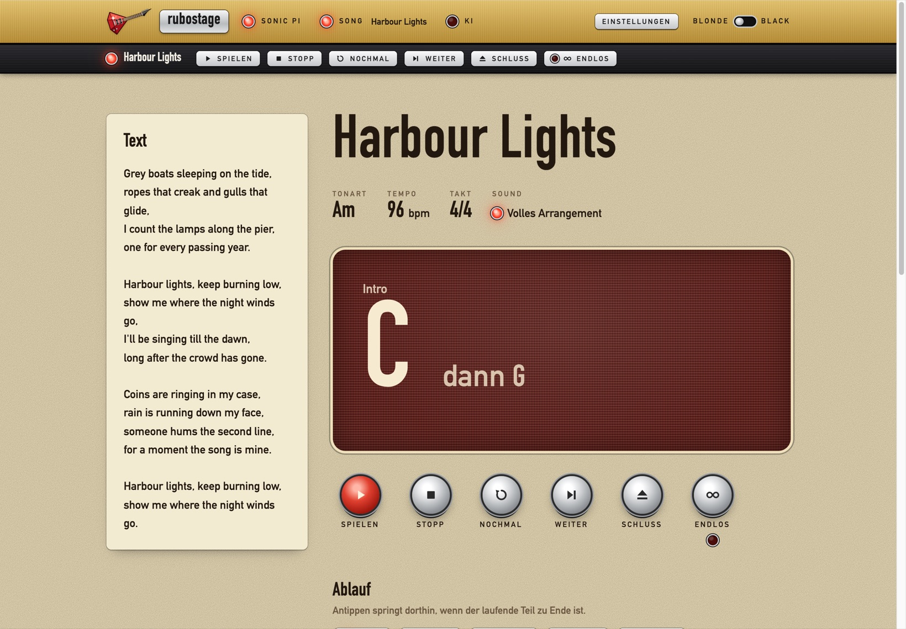
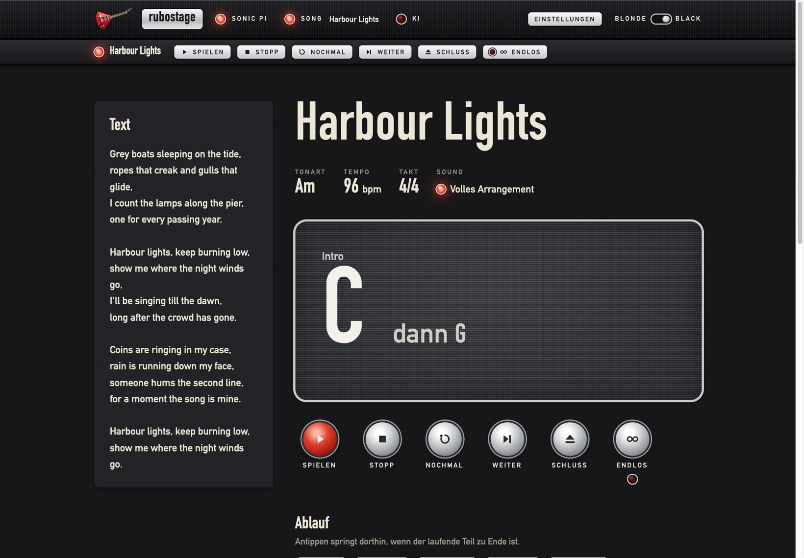
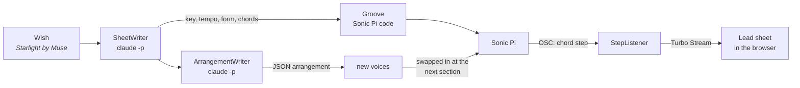

<p align="center">
  
</p>

<h1 align="center">rubostage</h1>

<p align="center">
  <strong>Name a song. Get a band.</strong><br>
  A play-along machine for busking: someone shouts a request, rubostage writes the chart,<br>
  Sonic Pi plays drums, bass and keys, and you sing and play guitar on top.
</p>

<p align="center">
  
</p>

---

## Why

Busking means taking requests you never rehearsed. rubostage turns
*"Do you know Seven Nation Army?"* into a backing band within seconds:
the chart comes from an AI, the music comes from [Sonic Pi](https://sonic-pi.net),
and the lead sheet follows along chord by chord, so your hands can stay on the
guitar.

It shows **form and chords only**. Lyrics and melody are yours.

## What it does

- **Wish in, groove out.** Type a song and an artist. A few seconds later a
  basic groove is playing in the right key and tempo.
- **Then the full arrangement.** In the background the AI writes a proper
  arrangement: drum style, bass, keys, guitar part, energy per section. It is
  swapped in *while the song plays*, at the next section boundary, without
  losing your place in the form.
- **A lead sheet that follows.** Sonic Pi reports every chord change. The page
  shows the current chord big, the next one small, and marks the part of the
  form you are in.
- **Steer it with your feet.** Well, with keys: repeat the part, skip to the
  next, jump anywhere in the form, or play the ending. Every command lands
  cleanly at a section boundary.
- **Fix what the AI got wrong.** Edit title, key, tempo, form, chords, and per
  section the groove, energy, swing and guitar style. Add riffs as plain ASCII
  guitar tabs. Saving while the song plays updates it in place.
- **Works offline.** Every song you have made plays again without a network.
  Only new requests need the AI.
- **Take it home.** "Ins Repo" exports a song as a standalone Sonic Pi file
  plus notes into a band's repository, so it lives on without the app.

## The control bar

Across the top sits an amp's control plate with three pilot lamps:

| Lamp | Lit | Blinking |
|------|-----|----------|
| **Sonic Pi** | the Sonic Pi server is up | Sonic Pi is starting. When it is off, a *Starten* button opens it |
| **Song** | Sonic Pi is reporting chords, with the song title next to it | — |
| **KI** | the AI is writing a chart or an arrangement | — |

The switch on the right flips between the two amps the design is modelled on:
**Blonde** (light) and **Blackface** (dark).

<p align="center">
  
</p>

## How it works



1. **`SheetWriter`** asks the AI for a lead sheet: title, artist, key, tempo,
   form and chords per section.
2. **`Groove`** turns it into Sonic Pi code: a `:conductor` live loop walks
   through the form and cues each section, the voices `sync` to it. The code is
   checked (`CodeCheck`) before it is sent.
3. **`ArrangeSongJob`** asks for the full arrangement as JSON, not as code:
   sounds from a fixed list, 16-step patterns, drum grooves
   (`rock`, `halftime`, `shuffle`, `funk`, `four_floor`, `punk`, `ballad`),
   guitar styles and energy 1–3 per part. rubostage writes the code itself, so
   the AI cannot break the music.
4. Sonic Pi sends every chord step over OSC to UDP port 4570. **`StepListener`**
   runs inside the Rails server and pushes it to the page via Turbo Streams.
5. Commands are written into Sonic Pi's time state. The conductor reads them at
   the next section boundary.

### Bring your own LLM

Out of the box the AI is reached through the local `claude` CLI (`claude -p`),
so no API key is needed. That is a convenience, not a dependency: the writers
only need an object that answers `#call(prompt)` with text. `ClaudeCli` is
nothing more than that, and any LLM call can take its place, for example through
[RubyLLM](https://rubyllm.com):

```ruby
# app/models/ruby_llm_client.rb
class RubyLLMClient
  def initialize(model: "claude-sonnet-5-5")
    @model = model
  end

  def call(prompt)
    RubyLLM.chat(model: @model).ask(prompt).content
  end
end
```

Both writers take the client as an argument:

```ruby
SheetWriter.new(client: RubyLLMClient.new)
ArrangementWriter.new(client: RubyLLMClient.new)
```

Swap the default in those two places and rubostage talks to whichever provider
RubyLLM is configured for: Anthropic, OpenAI, Gemini, or a local model via
Ollama.

## Requirements

- macOS (Sonic Pi is started with `open -a`, fonts are macOS system fonts)
- Ruby 3.4.7 and SQLite
- [Sonic Pi 5](https://sonic-pi.net): `brew install --cask sonic-pi`
- [Claude Code](https://claude.com/claude-code), logged in, for `claude -p`, or any other LLM (see [Bring your own LLM](#bring-your-own-llm))

## Getting started

```bash
git clone git@github.com:rstammer/rubostage.git
cd rubostage
bin/setup --skip-server
tail -f /dev/null | PORT=4567 bin/dev
```

Open <http://localhost:4567> and press **Starten** in the control bar if Sonic Pi
is not running yet.

> `tail -f /dev/null` keeps stdin open. Without it `tailwindcss:watch` exits and
> foreman takes the whole server down with it.

## Keyboard

The page listens to the keyboard, so you never have to let go of the guitar
for long.

| Key | Action |
|-----|--------|
| <kbd>P</kbd> | play |
| <kbd>S</kbd> / <kbd>Esc</kbd> | stop |
| <kbd>R</kbd> | repeat the current part |
| <kbd>N</kbd> / <kbd>→</kbd> | next part |
| <kbd>E</kbd> | play the ending |
| <kbd>1</kbd>–<kbd>9</kbd> | jump to that part of the form |

## Riffs as tabs

In the editor every section can carry a riff, written the way guitarists write
them anyway:

```
e|----------------|----------------|
B|----------------|----------------|
G|----------------|----------------|
D|----------------|----------------|
A|--7--7-10-7-5-3-|-2--------------|
E|----------------|----------------|
```

One character is a sixteenth, 16 per bar. `x` is a dead note, `-` lets it ring.
Tunings: standard, drop D, half a step down and D standard. Riffs repeat until
their section ends.

## Exporting songs

**Ins Repo** writes `<songs>/<song>/live.rb` and `NOTES.md`. The `live.rb` plays
on its own, without the app. Point `SONGS_ROOT` at a band's songs folder:

```bash
SONGS_ROOT=../mcblinded/songs PORT=4567 bin/dev
```

Without it, songs land in `exports/` (gitignored). Exported files carry a mark
in their first line and are overwritten by the next export. A file without the
mark counts as hand-written and is never touched.

## Playing without the app

`bin/play` sends a file straight to Sonic Pi, through the same client the app
uses:

```bash
bin/play examples/starlight/live.rb
bin/play -e 'set :section, :verse'
bin/play --stop
bin/play --status
bin/play --record examples/starlight/live.rb -o take.wav -t 30
```

[`examples/starlight/`](examples/starlight) is the hand-written play-along the
generated grooves are modelled on.

## Sonic Pi, the hard way

rubostage talks OSC to Sonic Pi directly, with no gem in between. A few things
learned along the way:

- **Port and token change on every Sonic Pi restart.** Sonic Pi 5 no longer logs
  them. They are read from the spider server's process arguments each time.
- **Send to `127.0.0.1`, not `localhost`.** On macOS `localhost` resolves to
  `::1` first, the server only listens on IPv4, and the packets vanish
  silently.
- **macOS drops UDP datagrams over 9216 bytes.** Longer code is written to a
  file and handed over with `run_file`.
- **Sonic Pi's own Ruby dies on Bundler's environment.** When the app starts
  Sonic Pi, it clears `RUBYOPT`, `GEM_HOME` and `BUNDLE_GEMFILE` first.
- **Built-in function names cannot be variable names.** `ring`, `line`,
  `range` and friends make Sonic Pi reject the whole buffer. `CodeCheck` catches
  that before sending.

## Development

```bash
bundle exec rspec        # tests
bundle exec standardrb   # style
bin/rails zeitwerk:check
```

Specs cover everything that is plain Ruby: lead sheets, arrangements, grooves,
tabs, the editor, export, the OSC client. Sound is checked by ear, and by
recording takes with `bin/play --record`.

## Origin

rubostage grew out of [mcblinded](https://github.com/rstammer/mcblinded), the
new incarnation of the band Blackminded, where it started as `stage/`. It now
stands on its own and works for any band, or for one person with a guitar on a
street corner.
